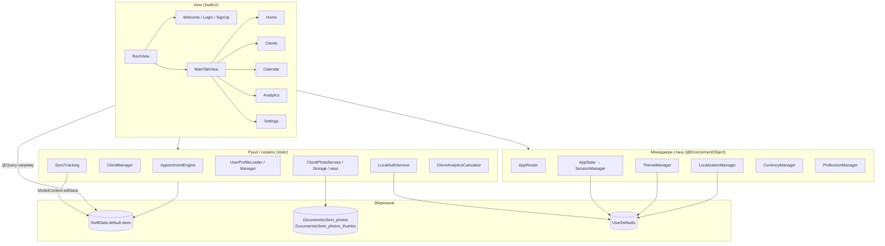
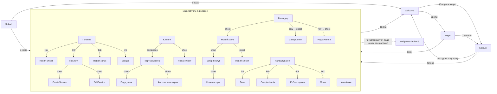
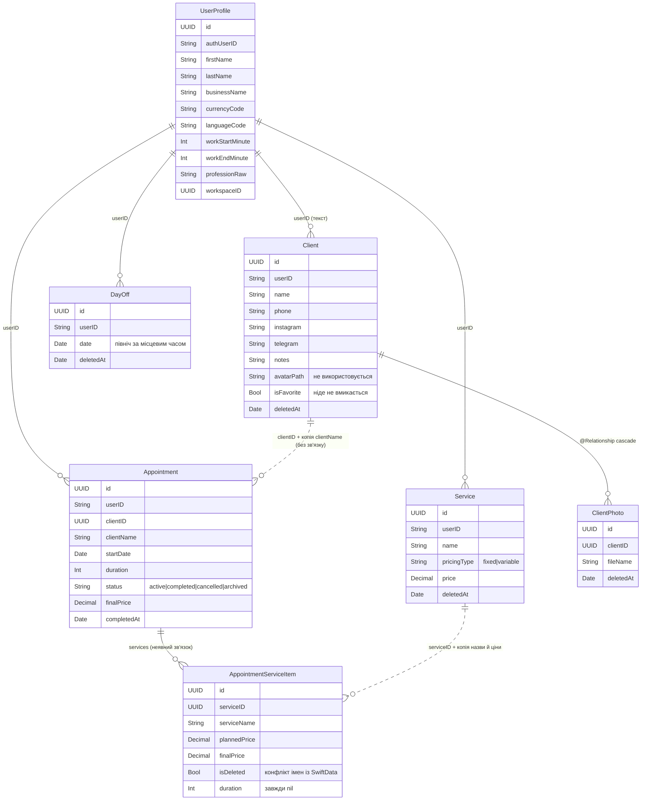

# Технічний аудит Beauty Base

**Дата:** 28.10.2026. **Гілка:** `chore/app-audit`, від `main` `eb8d241` (після злиття `feature/profession-system`).
**Обсяг:** 105 Swift-файлів, ~12 000 рядків коду додатку. Аудит нічого не змінював у коді додатку: додано лише тести, скріншоти й ці документи.

Супутні файли:
- [features.md](features.md): повний перелік функцій;
- [ui-inventory.md](ui-inventory.md): інвентар UI для дизайн-системи;
- [screenshots/](screenshots/): скріншоти всіх екранів у 3 темах, у світлому й темному режимі iPhone;
- [run-screenshots.sh](run-screenshots.sh): скрипт, що повторює зйомку скріншотів.

---

## 1. Коротко

Додаток у хорошому робочому стані. Збірка проходить без жодного попередження в коді. Основні сценарії продумані й працюють: клієнти, записи, завершення з фінальною ціною, аналітика. Гроші скрізь у `Decimal`, видалення м'яке, поля для синхронізації вже на місці, тож фундамент під Supabase закладено правильно.

Головні ризики:
- **безпека входу** (пароль відкритим текстом, немає видалення акаунта): відомо, закривається етапом 4 плану;
- **цілісність грошей у записах**: редагування запису мовчки переписує ціни й прибирає послуги;
- **бізнес-правила живуть в екранах**: рушій їх не перевіряє, а аналітику й захист від дублікатів неможливо протестувати. Для веб-версії й синхронізації ці правила доведеться переносити.

Візуально додаток неоднорідний:
- є 3 різні стилі полів вводу й 10 різних радіусів заокруглень;
- Вхід і Реєстрація ігнорують теми;
- у темному режимі iPhone Календар (Classic) і Головна (Graphite) майже нечитабельні: текст зливається з фоном.

Окремо: на iOS 26.2 частина тестів аварійно завершується. На 26.4 і 26.5 їх немає. Чи стосується це живих користувачів на старих iOS, треба перевірити на пристрої.

---

## 2. Архітектура

### 2.1 Шари

Помітно, що екрани часто ходять у базу напряму (`@Query`, `context.save()`). Частина бізнес-логіки, а саме аналітика, дублікати клієнтів і правила статусів, лежить усередині View, в обхід рушіїв.

### 2.2 Навігація

`AppRouter` має 5 станів: `splash`, `welcome`, `login`, `signUp` і `main`. Перемикання між ними робить `RootView` через `switch`, тому анімацій переходу між станами немає. Усередині `main` кожна вкладка має свій `NavigationStack`.

На Головній «Новий клієнт» і «Новий запис» відкриваються через `NavigationLink`, а в Клієнтах і Календарі ті самі форми відкриваються як sheet. Самі форми мають власний `NavigationStack`, тож вийшов вкладений стек: подвійна навігація й немає кнопки «Скасувати».

### 2.3 Що де зберігається

| Сховище | Що лежить | Хто пише |
|---|---|---|
| SwiftData (`default.store`) | `UserProfile`, `Client`, `ClientPhoto`, `Appointment`, `AppointmentServiceItem`, `Service`, `DayOff` | екрани та рушії |
| `Documents/client_photos/<uuid>.jpg` | повні фото (JPEG 0.8) | `ClientPhotoStorage.saveImage` |
| `Documents/client_photos_thumbs/<uuid>.jpg` | мініатюри 300 пт (JPEG 0.7) | `ClientPhotoStorage.saveThumbnail` |
| `UserDefaults["local_users"]` | **усі акаунти: email + пароль відкритим текстом** + userID (JSON) | `LocalAuthService` |
| `UserDefaults["session_user"]` | userID того, хто ввійшов | `SessionManager` |
| `UserDefaults["app_language"]` | код мови інтерфейсу (дублюється в `UserProfile.languageCode`) | `LocalizationManager` |
| `UserDefaults["app_theme"]` | тема (лише на цьому пристрої, не в профілі) | `ThemeStorage` |
| Пам'ять (`NSCache`) | `PhotoThumbnailCache` (на ділі повні фото), `PhotoMemoryCache` (мініатюри, 300 шт. / 50 МБ) | фото-сервіси |

### 2.4 Моделі та зв'язки

Усі синхронізовані моделі також мають поля `workspaceID`, `updatedAt` і `deletedAt`.

---

## 3. Моделі й цілісність даних

| Модель | Створює | Змінює | Видаляє |
|---|---|---|---|
| `UserProfile` | `SignUpFlowView.finishRegistration` | мова: `LanguageSettingsView`; спеціалізація: `ProfessionManager.choose`; години: `WorkingHoursSettingsView`; `workspaceID`: `SyncTracking.prepareWorkspace` | ніхто (видалення акаунта немає) |
| `Client` | `ClientFormView` | `ClientFormView` (редагування) | `ClientManager.delete` (м'яко, разом з фото) |
| `ClientPhoto` | `ClientPhotoService.addPhoto` | — | `ClientPhotoService.deletePhoto`, `ClientManager.delete` (м'яко + файл) |
| `Appointment` | `AppointmentEngine.createAppointment` | `updateAppointment`, `complete`, `cancel`, «Приховати» у `AppointmentRow` (`status = .archived`) | не видаляється (статуси) |
| `AppointmentServiceItem` | рушій записів | `complete` (фінальна ціна) | при редагуванні запису старі елементи замінюються новими |
| `Service` | `CreateServiceView`, `ServicePickerView` | `EditServiceView` (прив'язка напряму до моделі) | `ServicesListView.delete` (м'яко) |
| `DayOff` | `DayOffPickerView`, довгий натиск у `CalendarDayCell` | — | там само (м'яко) |

Перевірки:

- **Запис після видалення клієнта.** Запис лишається, `clientID` і `clientName` не змінюються, дохід лишається в аналітиці ✅ (тест `testDeletingClientKeepsAppointmentsAndRevenue`). Проте:
  - майбутні активні записи видаленого клієнта лишаються в календарі;
  - відредагувати такий запис не можна: клієнта не знайдено, тож кнопка «Зберегти» неактивна;
  - якщо клієнта перейменували, у старих записах лишається старе ім'я, бо `clientName` оновлюється лише під час редагування запису.
- **Послуга в записі після видалення з прайсу.** Назва й ціна збережені в записі ✅. Але при **редагуванні** такого запису видалена послуга мовчки зникає з нього, а решта цін перераховується за поточним прайсом ❌ (тести `testUpdateKeepsServiceDeletedFromPriceList`, `testUpdateRepricesFromCurrentPriceList`).
- **М'яке видалення.** Скрізь `markDeleted()`, жодного `context.delete` ✅. Фільтр `deletedAt == nil` є в усіх запитах клієнтів, послуг і вихідних ✅. Фото фільтруються в `ClientPhotoGridSection.swift:24` ✅.
- **Фільтр «чиї дані».**
  - Жоден `@Query` не фільтрує за `userID`: усі 11 запитів беруть записи всіх акаунтів на пристрої, а потім відсіюють їх у пам'яті через `appState.session.userID` ⚠️.
  - Майже скрізь це відсіювання є. **Винятки**: `ClientAnalyticsSection` (фільтрує лише за `clientID`, тож витоку немає) і `ServicePickerView` (фільтрує ✅).
  - `workspaceID` для фільтрів ніде не використовується; це очікувано до синхронізації.
- **Гроші.** Усі суми в `Decimal` ✅; `Double` лише для малювання графіка. Проте введення ціни в двох місцях іде через `TextField(format: .number)` з мовою пристрою, а не через `AppFormatting.parseMoney`: це `AppointmentFormView.swift:358` (змінна ціна) і `EditServiceView.swift:30`.
- **Фото-«сироти».** Повне фото видаляється з диска, а **мініатюра лишається назавжди** (`client_photos_thumbs`) ❌ (тест `testPhotoDeletionRemovesThumbnailToo`). Те саме при видаленні клієнта. Кеш `PhotoMemoryCache` теж не чиститься. Ще один шлях до «сироти»: якщо `context.save()` після запису файлу не вдасться, помилку проковтне `try?`.

---

## 4. Знахідки

🔴 — критично (до релізу обов'язково), 🟠 — важливо, 🟢 — дрібниця.

| № | | Що не так | Де | Чим загрожує | Як виправити |
|---|---|---|---|---|---|
| 1 | 🔴 | Паролі всіх акаунтів лежать у UserDefaults відкритим текстом (відомо) | `Auth/LocalAuthService.swift:38` | Будь-хто з резервною копією телефону бачить пароль; відмова App Review | Етап 4: Supabase Auth, токени в Keychain, локальні паролі прибрати |
| 2 | 🔴 | Немає видалення акаунта й Sign in with Apple (відомо) | `Settings/SettingsView.swift` | Відмова App Store (правило 5.1.1(v)) | Етап 4 плану |
| 3 | 🔴 | Редагування запису мовчки прибирає послуги, видалені з прайсу, і перераховує ціни за новим прайсом | `Appointment/Views/AppointmentFormView.swift:678`, `AppointmentEngine.swift:190` | Майстер змінив лише час, а сума запису змінилась або послуга зникла; неправильний дохід | Тримати в формі послуги запису як є (`AppointmentServiceItem`), підтягувати з прайсу лише нові |
| 4 | 🟠 | На iOS 26.2 тести, що створюють і знищують звичайні класи (менеджери, `SignUpState`, `LocalAuthService`), аварійно завершуються (`malloc: pointer being freed was not allocated`); на 26.4 і 26.5 усе гаразд. xcodebuild таке падіння **не рахує провалом** | 11 тестів у `ProfessionTests` і `AuditAccountRulesTests` | Можливе падіння додатку на старіших iOS, якщо такий об'єкт знищується поза головним потоком; тести на старих iOS «зелені» навіть з падіннями | Перевірити додаток на пристрої з iOS 17/18; позначити тестові класи `@MainActor`; стежити за виправленням у Swift/Xcode |
| 5 | 🟠 | Бізнес-правила статусів є лише в UI: рушій дозволяє завершити скасований запис, скасувати завершений і редагувати завершений (тоді фінальні ціни послуг губляться, а `finalPrice` лишається старим) | `Appointment/Engine/AppointmentEngine.swift:157, 212, 240` | Під час синхронізації чи у веб-версії дані зламаються; розбіжність сум | Перевірки статусу в рушії + `Result` з помилкою |
| 6 | 🟠 | Скасування запису без підтвердження й без можливості відмінити; повернути запис в активні неможливо | `Appointment/Views/AppointmentRow.swift:248` | Випадковий дотик = втрачений запис | Підтвердження + «Відновити» для скасованих |
| 7 | 🟠 | Захист від дублікатів лише за іменем: двох різних «Анна» створити не можна, телефон не враховується. Перевіряються лише перші 500 клієнтів. Логіка у View, тож її не протестувати | `Client/Views/ClientFormView.swift:152` | Майстер змушений писати «Анна 2»; при великій базі дублікати проходять | Перенести в `ClientManager`; дублікат = ім'я + телефон; попереджати, а не забороняти |
| 8 | 🟠 | Топ клієнтів в аналітиці групується за **іменем** з копії в записі. Однофамільці зливаються, перейменований клієнт розпадається на двох | `Analytics/AnalyticsView.swift:314` | Неправильна аналітика | Групувати за `clientID`, ім'я брати з актуального `Client` |
| 9 | 🟠 | Помилки збереження ковтаються: 21 `try? context.save()` і 11 `print(error)`, користувач нічого не бачить | `AppointmentRow`, `DayOffPickerView`, `EditServiceView`, `ProfessionManager`… (див. 5.3) | Майстер думає, що зберіг, а дані втрачено | Спільний `save()` з показом помилки (alert/банер) |
| 10 | 🟠 | Помилка в формі запису показує системний англійський текст «The operation couldn't be completed (BeautyCRM.AppointmentError error 0)» | `AppointmentFormView.swift:627, 650` | Незрозуміле повідомлення будь-якою мовою | Ключі `appointment.error.*` у 5 мовах |
| 11 | 🟠 | Введення грошей: `parseMoney` бере лише початок рядка («12.5.3» → 12,5; «12abc» → 12), «1.234,50» читає як 1,234. При завершенні запису невалідний або порожній текст стає **0** | `Utils/AppFormatting.swift:108`, `AppointmentRow.swift:414` | Дохід 0 € замість реальної суми без попередження | Сувора перевірка, роздільник тисяч, підсвічувати поле з помилкою |
| 12 | 🟠 | Послуга зі змінною ціною зберігається в запис з ціною 0, якщо суму не ввели | `AppointmentEngine.swift:132` | Дохід занижено | Вимагати суму або явно «уточнити при завершенні» |
| 13 | 🔴 | Темний режим iPhone ламає інтерфейс. **Classic:** назва місяця й числа в календарі чорні на чорному, кнопка «+» чорна на чорному фоні (іконки не видно), картки лишаються білими. **Graphite:** картки стають темними, а текст і цифри на них теж темні, тож «3 записи», ім'я клієнта й час не прочитати | `Theme/ThemeManager.swift:44–82, 105` | Багато майстрів користуються темним режимом: для них Календар і Головна майже нечитабельні (`screenshots/classic-dark/13-calendar.png`, `graphite-dark/08-home.png`) | Швидко: `.preferredColorScheme(.light)` у `BeautyCRMApp`. Правильно: окремі темні палітри тем |
| 14 | 🟠 | Валюту можна обрати лише при реєстрації; ім'я й назву салону змінити ніде | `Settings/SettingsView.swift` | Помилку при реєстрації не виправити | Екран «Профіль» у Налаштуваннях |
| 15 | 🟠 | Три різні назви продукту: «Beauty CRM» (Welcome, Splash), «BeautyBook» (Головна), «BeautyCRM» (`Constants`); у задачі «Beauty Base» | `WelcomeView.swift:73`, `SplashView.swift:27`, `HomeHeaderView.swift:21`, `Utils/Constants.swift:10` | Плутанина в бренді | Одна назва з одного місця (`Constants`) |
| 16 | 🟠 | Аналітика, правила дублікатів і статусів зашиті у View (`private`), тож не тестуються і не перенесуться у веб | `AnalyticsView.swift` (1279 рядків) | Помилки в розрахунках непомітні; дублювання логіки у веб-версії | Винести в `AnalyticsEngine` (чисті функції) + тести |
| 17 | 🟢 | Запис на вихідний день створюється без попередження; найближчий слот не враховує робочі години, вихідні й час **до** зайнятого запису | `AppointmentEngine.swift:46, 99` | Майстер записує клієнта на вихідний; підказка «19:00» після кінця дня | Передавати в рушій робочі години й вихідні |
| 18 | 🟢 | Мініатюри фото лишаються на диску після видалення фото чи клієнта; кеш пам'яті не чиститься | `ClientPhotoStorage.swift:83`, `ClientPhotoService.swift:49` | Пам'ять телефону поступово заповнюється | Видаляти й мініатюру |
| 19 | 🟢 | Фото стискаються (JPEG + мініатюра) у головному потоці | `ClientPhotoGridSection.swift:274`, `ClientPhotoService.swift:15` | Інтерфейс «замерзає» при додаванні кількох великих фото | Стиснення у фоні, в базу — на головному |
| 20 | 🟢 | Усі `@Query` для записів без фільтра; похідні масиви перераховуються кілька разів за кожне перемальовування (у Аналітиці ~10 разів) | `HomeView:15`, `CalendarScreen:17`, `AnalyticsView:25`, `AppointmentFormView:51`, `ClientAnalyticsSection:17` | Сповільнення при тисячах записів | Предикат за `userID` і періодом; кешувати обчислене |
| 21 | 🟢 | `NumberFormatter` і `DateFormatter` створюються при кожному виклику; гроші форматуються за мовою **пристрою**, а не додатку | `CurrencyManager.swift:58`, `AppFormatting.swift`, `HomeView.swift:360` | Зайва робота; формат «1.234,50 €» може не збігатися з мовою додатку | Кешовані форматери з `localization.locale` |
| 22 | 🟢 | Не перекладено: «OK» (2), «Price», «Current week», «🌐 Language», «Beauty CRM»; назви валют англійською (`SupportedCurrency`), хоча ключі `currency.*` є; `AnalyticsPeriod.title/subtitle` англійською | `ClientFormView.swift:90`, `AppointmentRow.swift:318`, `AppointmentFormView.swift:359`, `AnalyticsView.swift:597`, `WelcomeView.swift:47` | Змішані мови в інтерфейсі | Ключі в 5 мов |
| 23 | 🟢 | У кожному `Localizable.strings` 5 ключів записано двічі (`common.cancel`, `common.change`, `settings.language.*`), і 11 ключів ніде не використовуються | `Language/*.lproj` | Плутанина, який переклад діє | Прибрати дублікати й зайве |
| 24 | 🟢 | Мертвий код: `ServiceRow` (158 рядків), `CurrencyFormatter`, `Constants`, `DateFormatter.shortDate`, `AuthUser`, `AuthValidationError`, `ClientManager.createClient`, `ServiceEngine.calculatePrice`, `UserProfileManager.create/update`, `AppFormatting.dateTime`, `getOptimizedImage`, `AnalyticsPeriod.title/subtitle`, алерт нотаток у `AppointmentRow`; порожні папки `cs/en/uk.lproj` у корені | див. 5.1 | Читати й підтримувати важче | Видалити одним комітом |
| 25 | 🟢 | `Client.isFavorite` (VIP) і `avatarPath` ніде не вмикаються | `Client/Models/Client.swift:31,35` | Готова функція недоступна | Додати перемикач «VIP» або прибрати |
| 26 | 🟢 | Instagram і Telegram з «@» дають неправильне посилання (`instagram.com/@nick`); `URL(string:)!` з примусовим `!` | `ClientContactSection.swift:26–59` | Посилання не відкривається; теоретично падіння на дивному вводі | Чистити «@» і пробіли, без `!` |
| 27 | 🟢 | Вхід, Реєстрація, Splash не використовують тему (`.pink`, `.white`, `.blue`) | `LoginView.swift`, `SignUp/*`, `SplashView.swift` | Різний вигляд, неочікуваний рожевий у темі Graphite | Наступна задача (редизайн входу) |
| 28 | 🟢 | Classic: `textMuted = systemGray6` (майже білий) на білих картках | `ThemeManager.swift:54` | Порожні кружечки вибору спеціалізації не видно | Темніший сірий |
| 29 | 🟢 | Порожніх станів немає для списку клієнтів, прайсу, пошуку й аналітики | `ClientsListView`, `ServicesListView`, `AnalyticsView` | Новий майстер бачить пустий екран | Компонент `EmptyState` |
| 30 | 🟢 | Редагування послуги змінює модель «наживо»: свайп униз = зміни лишаються, назва може стати порожньою | `Services/EditServiceView.swift:27` | Випадкові зміни прайсу | Локальний стан + «Зберегти» / «Скасувати» |
| 31 | 🟢 | Ім'я клієнта зберігається з пробілами по краях | `ClientFormView.swift:215` | Пошук і сортування «з пробілом» | `trimmingCharacters` при збереженні |
| 32 | 🟢 | Вихідний зберігається як північ за місцевим часом | `Home/DayOff.swift:34` | Після зміни часового поясу вихідний «переїде» на сусідній день | Зберігати дату як рядок `yyyy-MM-dd` або в UTC |
| 33 | 🟢 | `print` у робочому коді: userID при реєстрації, мова й валюта, помилки. Персональних даних клієнтів у логах немає ✅ | 11 місць (див. 5.2) | Сміття в логах | `Logger` з рівнями або прибрати |
| 34 | 🟢 | Вхід показує одну загальну помилку для «немає акаунта» і «неправильний пароль». Для безпеки це навіть добре, але `auth.error.userNotFound/wrongPassword` не використовуються | `LoginView.swift:211` | — | Залишити загальну, прибрати зайві ключі (або Supabase) |
| 35 | 🟢 | На iPhone дозволено альбомну орієнтацію, але екрани під неї не верстались | `project.pbxproj` (`UISupportedInterfaceOrientations_iPhone`) | Поламані макети при повороті | Лише портретна |
| 36 | 🟢 | Тексти дозволів на фото лише англійською | `INFOPLIST_KEY_NSPhotoLibrary*` | Системний запит англійською | `InfoPlist.strings` у 5 мовах |
| 37 | 🟢 | Тема зберігається на пристрої, а не в профілі; вихід з акаунта не скидає валюту | `ThemeStorage`, `SessionManager.logout` | На новому телефоні тема скинеться | Тема в `UserProfile` разом із синхронізацією |
| 38 | 🟢 | Аналітика тижня показує лише **поточний** тиждень, попередні не переглянути | `AnalyticsView.swift:154` | Обмеження функції | Перемикач тижнів як для місяця |
| 39 | 🟢 | `AppointmentServiceItem.isDeleted` збігається з вбудованою властивістю SwiftData (відомо) | `Services/AppointmentServiceItem.swift:23` | Непередбачувана поведінка фільтра на Головній | Перейменувати при міграції |
| 40 | 🟢 | `UILaunchScreen` і Splash: фіксована затримка 1 с без логотипу | `Auth/SplashView.swift:37` | Зайва секунда при кожному запуску | Прибрати затримку |
| 41 | 🟢 | Вибрана картка спеціалізації збільшується на 2% (`scaleEffect(1.02)`), і її рамка обрізається по краях екрана | `Profession/ProfessionPickerView.swift:111` | Неохайний вигляд (`screenshots/classic/05-signup-3-profession.png`) | Прибрати масштаб або додати відступ |
| 42 | 🟢 | Імена клієнтів у рядку запису сірі (`textSecondary`), так само як послуги й час: головне не виділено | `Appointment/Views/AppointmentRow.swift:97` | Список записів важко читати | Ім'я — `textPrimary` |
| 43 | 🟢 | Немає `accessibilityIdentifier`, тому UI-тести шукають кнопки за текстом; системне вікно «Зберегти пароль?» з'являється після кроку з паролем | увесь UI | UI-тести крихкі й залежать від мови | Ідентифікатори на ключових кнопках і полях; `textContentType` для полів входу |

---

## 5. Якість коду: подробиці

### 5.1 Збірка
- Чиста збірка (`xcodebuild clean build`, iPhone 17, Debug): **успішна, 0 попереджень у коді**.
- Єдине попередження — від інструмента Xcode, не від коду: `appintentsmetadataprocessor: Metadata extraction skipped. No AppIntents.framework dependency found.` Нічого робити не треба.

### 5.2 `print` (11)
`AppointmentFormView.swift:85`, `SignUpFlowView.swift:189` (userID), `:211`, `UserProfileLoader.swift:56` (мова, валюта), `ClientsListView.swift:233`, `ClientFormView.swift:190, 200, 243`, `ClientPhotoStorage.swift:43, 94`, `LanguageSettingsView.swift:170, 178`. Імен, телефонів і нотаток клієнтів у логах немає ✅.

### 5.3 Примусові `!`, `try!`, `try?`
- `try!`: 0 ✅.
- `!` — 8 місць:
  - `AppointmentEngine.swift:57, 77, 116, 173` (додавання хвилин до дати; безпечно на практиці);
  - `CalendarPagerView.swift:114`;
  - `ClientContactSection.swift:29, 44, 59` (`URL(string:)!`; з iOS 17 пробіли кодуються автоматично, тест `testContactLinksDoNotCrashOnTypicalInput` ✅).
- `try?`, що ковтають **збереження**: `AppointmentRow.swift:253, 270, 424` (скасувати, приховати, завершити!), `CalendarDayCell.swift:95`, `DayOffPickerView.swift:125`, `ClientPhotoService.swift:38, 57`, `ProfessionManager.swift:37`, `EditServiceView.swift:45`, `CreateServiceView.swift:166`, `ServicesListView.swift:256`, `ServiceRow.swift:156`, `SettingsView.swift:264`, `SyncTracking.swift:158`, `UserProfileManager.swift:69, 97`.
- Записи на прийом **не викликають** `context.save()` після створення й редагування: `AppointmentFormView.swift:608–650`. Вони покладаються на автозбереження SwiftData, тож якщо закрити додаток одразу, запис можна втратити.

### 5.4 Локалізація
- Ключів у кожній мові: 239. Відсутніх у якійсь із 5 мов: **0** ✅.
- Дублікатів у кожному файлі: 5. Невикористаних ключів: 11 (`calendar.title`, `currency.*` ×6, `validation.error.*` ×4).
- Текстів у UI без ключа: див. знахідку 22.

### 5.5 Кольори, шрифти, відступи напряму
44 кольори в обхід теми у 20 файлах, 10 різних радіусів, 17 різних відступів. Подробиці в [ui-inventory.md](ui-inventory.md).

### 5.6 Дублювання
- Плаваюча кнопка «+» скопійована 3 рази.
- Картка послуги існує двічі (`ServicesListView.serviceCard` і мертвий `ServiceRow`), видалення послуги теж двічі.
- Картка показника: `ClientStatCard` і `AnalyticsView.analyticsCard`.
- Два кеші фото з майже однаковим кодом: `PhotoThumbnailCache` і `PhotoMemoryCache`.
- Два форматери валют: `CurrencyFormatter` і `CurrencyManager.format`.
- Пошук профілю за userID повторюється в 4 місцях: `UserProfileManager`, `UserProfileLoader`, `LanguageSettingsView`, `CalendarScreen`.
- `colors(for: currentTheme)` повторюється в ~36 View.

### 5.7 Файли поза target
Не знайдено: усі `.swift` з папок поза `BeautyCRM/` додано в target ✅.

---

## 6. Результати тестів бізнес-правил

**Як читати.** Тест, що описує знайдену ваду, обгорнуто в `XCTExpectFailure`. Тому прогін лишається «зеленим», а у звіті xcodebuild такий тест видно як «expected failure». Коли ваду виправлять, тест сам повідомить про це, і обгортку треба прибрати.

Прогін на iPhone 17 (iOS 26.2, послідовно):
- **70 тестів, з них 37 нових.** Провалився 1 старий шаблонний UI-тест `testLaunch`: тайм-аут знімка екрана, випадковий збій симулятора.
- На iOS 26.2 падали `AuditAccountRulesTests` (7) і 4 з `ProfessionTests` (знахідка 4). Їх окремо проганяли на **iOS 26.4 і 26.5: усі 20 пройшли**.

| Правило | Тест | Результат |
|---|---|---|
| Кінець одного = початок іншого — не накладка | `testBackToBackAppointmentsDoNotConflict` | ✅ |
| Перетин на 1 хв — накладка | `testOneMinuteOverlapConflicts` | ✅ |
| Запис через північ блокує наступний день | `testAppointmentOverMidnightConflictsWithNextDay` | ✅ |
| Скасовані, завершені й приховані не блокують | `testCancelledCompletedArchivedDoNotBlock` | ✅ |
| Редагування не конфліктує саме з собою | `testEditingIgnoresItself` | ✅ |
| Найближчий слот одразу після зайнятого | `testSuggestsSlotRightAfterConflictingAppointment` | ✅ |
| Слот пропускає замалі проміжки | `testSkipsTooSmallGap` | ✅ |
| Слот не пропонує вільний час **до** запису | `testSuggestionUsesFreeTimeBeforeFirstAppointment` | ℹ️ поведінку зафіксовано (пропонує лише пізніше) |
| Слот у межах робочих годин | `testSuggestionStaysWithinWorkingHours` | ❌ пропонує 19:00 після кінця дня |
| Запис на вихідний відхиляється | `testCreateOnDayOffIsRejected` | ❌ створюється |
| Редагування зберігає видалену з прайсу послугу | `testUpdateKeepsServiceDeletedFromPriceList` | ❌ послуга зникає |
| Редагування не змінює ціну | `testUpdateRepricesFromCurrentPriceList` | ℹ️ ціна змінюється на нову з прайсу |
| Завершення: статус, дата, сума `Decimal` | `testCompleteSetsStatusDateAndTotal` | ✅ 10,10 + 20,20 → 12,35 + 20,20 = 32,55 точно |
| Не можна завершити скасований | `testCannotCompleteCancelledAppointment` | ❌ рушій дозволяє |
| Не можна скасувати завершений | `testCannotCancelCompletedAppointment` | ❌ рушій дозволяє |
| Не можна редагувати завершений | `testEditingCompletedAppointmentKeepsTotalsConsistent` | ❌ дозволяє, суми розходяться (30 проти 45) |
| `parseMoney`: кома, крапка, пробіли, порожньо, текст | `testParseMoneyAcceptsCommaAndDot` | ✅ |
| `parseMoney` відкидає сміття в кінці | `testParseMoneyRejectsGarbageTail` | ❌ «12.5.3» → 12,5 |
| `parseMoney` «1.234,50» | `testParseMoneyGermanThousandsSeparator` | ❌ → 1,234 |
| Суми `Decimal` точні (10 × 0,1 = 1) | `testDecimalSumsAreExact` | ✅ |
| Змінна ціна без суми не зберігається | `testVariablePriceWithoutValueBecomesZero` | ❌ зберігається як 0 |
| Видалений клієнт: записи й дохід лишаються | `testDeletingClientKeepsAppointmentsAndRevenue` | ✅ |
| Видалення фото прибирає мініатюру | `testPhotoDeletionRemovesThumbnailToo` | ❌ мініатюра лишається |
| Посилання на телефон з пробілами не падають | `testContactLinksDoNotCrashOnTypicalInput` | ✅ (але `@nick` дає хибне посилання) |
| Статистика клієнта без візитів (ділення на нуль) | `testClientAnalyticsWithoutVisitsHasNoDivisionByZero` | ✅ |
| Статистика клієнта: лише завершені в доході, середній чек | `testClientAnalyticsCountsOnlyCompletedRevenue` | ✅ 75,50 / 2 = 37,75 |
| Тиждень з понеділка, неділя в тому ж тижні | `testSundayBelongsToWeekStartingMonday` | ✅ |
| Тиждень через Новий рік — один тиждень | `testWeekAcrossNewYearIsOneWeek` | ✅ |
| Межа місяця 23:59 / 00:00 | `testMonthBoundaryLastMinute` | ✅ |
| Реєстрація й вхід: усі 6 помилок, регістр email | `testSignUpAndLoginErrors` | ✅ (26.4/26.5) |
| Пароль не зберігається відкрито | `testPasswordIsNotStoredInPlainText` | ❌ відомо |
| Усі помилки входу й реєстрації перекладені в 5 мов | `testEveryAuthErrorIsTranslated` | ✅ (26.4/26.5) |
| Кроки реєстрації показують помилку | `testSignUpStepsShowErrors` | ✅ (26.4/26.5) |
| Профіль, мова, валюта, спеціалізація відновлюються після входу й перезапуску | `testLoaderRestoresLanguageCurrencyAndProfession` | ✅ (26.4/26.5) |
| Профілю немає — значення від попереднього акаунта | `testLoaderWithoutProfileKeepsPreviousValues` | ℹ️ валюта лишається від попереднього |

**Не вдалося перевірити тестами без зміни коду**, бо логіка `private` всередині View:
- дублікати клієнтів (регістр, пробіли, однакові імена з різними телефонами). За кодом: регістр, пробіли й діакритика не враховуються ✅, телефон не враховується ❌;
- аналітика: дохід за годину, середній чек, топи, порожні періоди. За кодом: ділення на нуль захищене ✅, топ клієнтів за іменем ❌, тиждень лише поточний;
- часовий пояс: дати рахуються в поточному поясі пристрою, окремої обробки немає.

Це окрема знахідка (16): такі правила треба винести з View в рушії, щоб їх можна було перевіряти тестами.

---

## 7. Скріншоти

- `ScreenshotTourTests` разом з `AuditDemoDataSeeder` реєструють вигаданого майстра «Demo Master» і заливають 7 вигаданих клієнтів, 4 послуги, записи на тиждень і 9 попередніх місяців, 3 абстрактні «фото» та вихідний.
- Потім тест обходить кожен екран у кожній темі. Повторити: `zsh docs/audit/run-screenshots.sh` (на окремому чистому симуляторі; робочий iPhone 17 Pro Max не чіпається).
- Мова скріншотів англійська, бо це мова додатку за замовчуванням і за її текстами тест знаходить кнопки (ідентифікаторів доступності в коді немає).

**Що знято** (iPhone 17, iOS 26.2, зменшено до 603×1311):

| Папка | Екранів | Примітка |
|---|---|---|
| `classic/` | 31 | усі екрани зі списку |
| `graphite/` | 30 | бракує `02-login` (тест зупинився на тайм-ауті симулятора) |
| `pearl-ivory/` | 31 | усі екрани |
| `classic-dark/` | 10 | темний режим iPhone, основні екрани |
| `graphite-dark/` | 31 | темний режим, усі екрани |
| `pearl-ivory-dark/` | 7 | темний режим, частково |

Нумерація файлів:
- 01–07 — вітання, вхід і 5 кроків реєстрації;
- 08 — Головна;
- 09–12 — клієнти: список, картка, фото, новий клієнт, редагування;
- 13–16 — календар: місяць і тиждень, розгорнутий запис, новий запис, редагування, вибір послуг, завершення;
- 17–18 — послуги;
- 19–21 — аналітика за тиждень, місяць і рік;
- 22–27 — налаштування, вихідні, тема, мова, спеціалізація, робочі години.

**Що показали скріншоти:**
- **Темний режим** (знахідка 13): у Classic не видно назви місяця, чисел календаря й кнопки «+»; у Graphite не видно тексту на картках Головної.
- **Вхід і реєстрація** однакові в усіх темах, з рожевою кнопкою та системним синім (знахідка 27).
- **Classic:** порожні кружечки вибору спеціалізації ледь помітні (знахідка 28); рамка вибраної картки обрізана (знахідка 41).
- **Назва «BeautyBook»** на Головній, а на вітанні «Beauty CRM» (знахідка 15).
- Основні робочі екрани (Головна, Календар, Клієнти, Аналітика) у світлому режимі всіх трьох тем виглядають акуратно й цілісно.

**Про сам тур.** На iOS 26.2 UI-тести дуже повільні: кожна тема йшла 15–60 хв. Інколи вони падають з тайм-аутом «Timed out while synthesizing event», через що частину тем дознімали повторним запуском. Помилок самого додатку під час туру не було: він не падав ні після реєстрації, ні після виходу й входу.

---

## 8. Пропозиція: майбутні задачі

Готові для перенесення в GitHub Issues.

### Пріоритет 1 — до релізу

1. **Авторизація через Supabase (етап 4).** Прибрати локальні паролі з UserDefaults, токени в Keychain, додати Sign in with Apple, відновлення пароля й видалення акаунта. Закриває знахідки 1 і 2.
2. **Не змінювати послуги й ціни запису при редагуванні.** Форма редагування має працювати з `AppointmentServiceItem` запису: видалені з прайсу послуги лишаються, ціни не перераховуються, якщо майстер їх не міняв. Тести вже готові: зняти `XCTExpectFailure`. Знахідка 3.
3. **Перевірити падіння на старих iOS.** Запустити додаток на пристрої або симуляторі з iOS 17, 18 і 26.2 і пройти реєстрацію, вихід і вхід. Позначити тестові класи `@MainActor`. Додати в CI тести на мінімальній підтримуваній iOS. Знахідка 4.
4. **Показувати помилки збереження.** Один спільний помічник `save(context)` з алертом замість 21 `try?` і `print`. Для записів — явне збереження після створення й редагування. Знахідки 9 і 10.
5. **Темний режим.** Або тимчасово зафіксувати світлий режим (`.preferredColorScheme(.light)`), або зробити темні варіанти тем. Знахідка 13.
6. **Одна назва продукту.** Визначитися з «Beauty Base», замінити «Beauty CRM» і «BeautyBook», брати назву з одного місця. Знахідка 15.

### Пріоритет 2 — якість даних і довіра

7. **Правила статусів у рушії.** Переходи `active → completed / cancelled`, `cancelled → archived / active` перевіряються в `AppointmentEngine`. Завершений запис не редагується. Знахідка 5.
8. **Скасування з підтвердженням і відновленням.** Діалог «Скасувати запис?» і кнопка «Відновити» для скасованих. Знахідка 6.
9. **Надійне введення грошей.** Компонент `MoneyField` на основі суворого `parseMoney`, з підсвіткою помилки. Порожня або невалідна фінальна ціна не стає 0. Змінна ціна вимагає суму. Знахідки 11 і 12.
10. **Дублікати клієнтів по-новому.** Логіка в `ClientManager`. Збіг імені й телефону — попередження «Можливо, це той самий клієнт?», а не заборона. Тести на регістр і пробіли. Знахідка 7.
11. **Аналітика в окремому рушії.** Винести розрахунки з `AnalyticsView` у `AnalyticsEngine`, групувати топ клієнтів за `clientID`, додати перегляд минулих тижнів і покрити тестами межі періодів. Знахідки 8, 16 і 38.
12. **Профіль у Налаштуваннях.** Зміна імені, назви салону й валюти. Знахідка 14.

### Пріоритет 3 — підготовка до дизайн-системи й прибирання

13. **Базові UI-компоненти.** `PrimaryButton`, `FloatingAddButton`, `CardContainer`, `StatTile`, `StatusBadge`, `EmptyState`, токени радіусів і відступів (див. [ui-inventory.md](ui-inventory.md), розд. 10). Знахідки 27–29.
14. **Порожні стани.** Клієнти, Послуги, Аналітика, пошук без результатів. Знахідка 29.
15. **Прибирання коду.** Мертвий код (знахідка 24), дублікати ключів і зайві ключі (23), неперекладені тексти (22), `print` (33), порожні папки `*.lproj`.
16. **Фото: мініатюри й фон.** Видаляти мініатюри разом з фото, стискати фото у фоні, об'єднати два кеші. Знахідки 18 і 19.
17. **Продуктивність запитів.** Предикати `userID` і періоду в `@Query`, кешовані форматери. Знахідки 20 і 21.
18. **Дрібниці форм.** Обрізати пробіли в імені клієнта, редагування послуги з «Скасувати», правильні посилання Instagram і Telegram, лише портретна орієнтація, переклад дозволів на фото. Знахідки 26, 30, 31, 35 і 36.
19. **Робочі години й вихідні в записах.** Попередження при записі на вихідний; найближчий слот у межах робочого дня, включно з часом до зайнятого запису. Знахідка 17.
20. **VIP-клієнти.** Перемикач «VIP» у формі клієнта, фільтр у списку. Знахідка 25.
